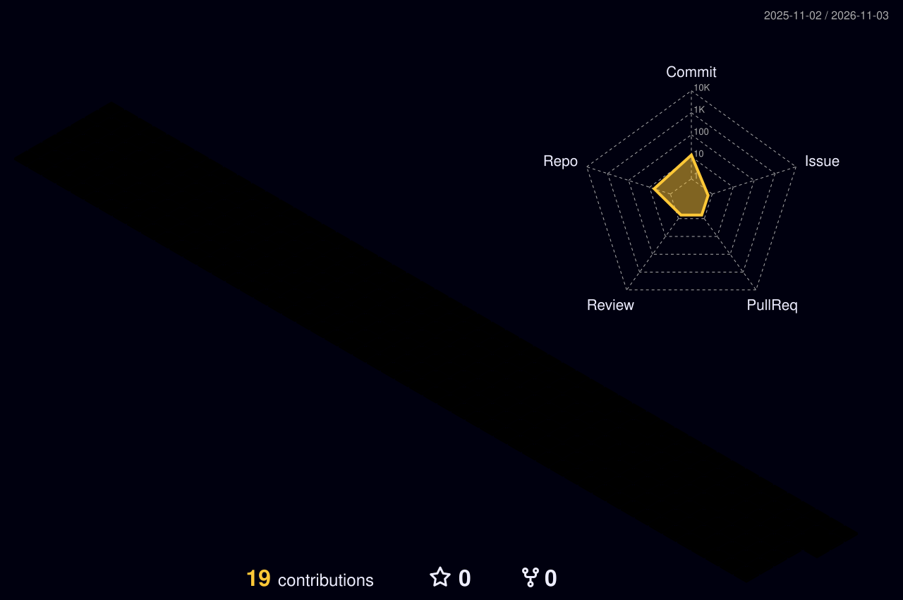
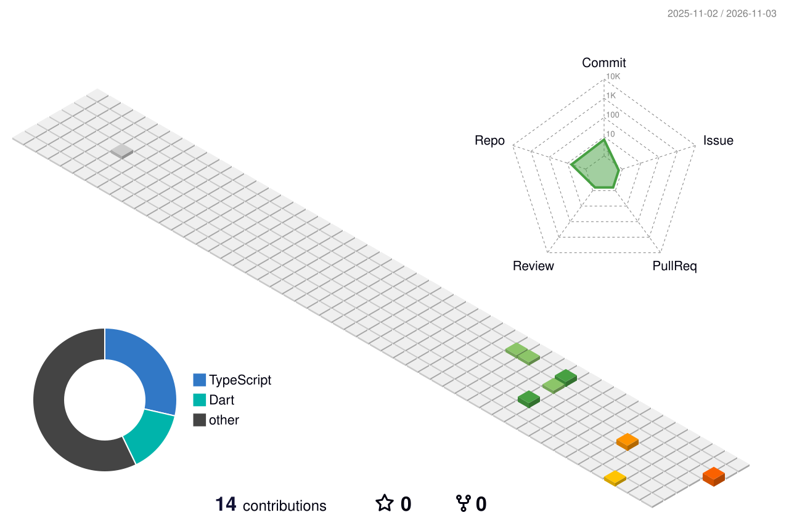
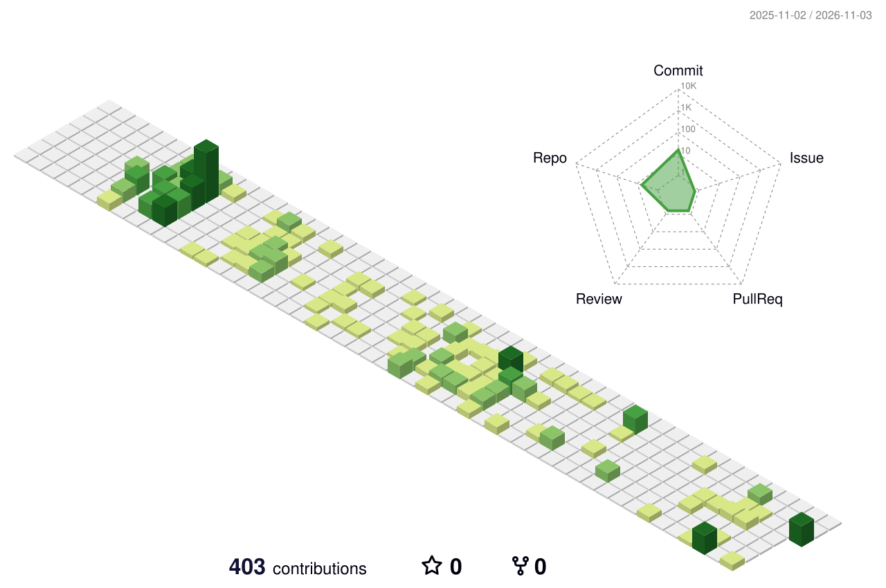
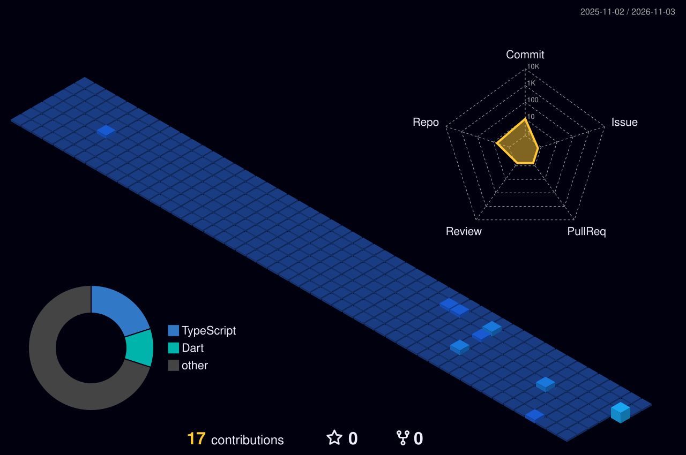
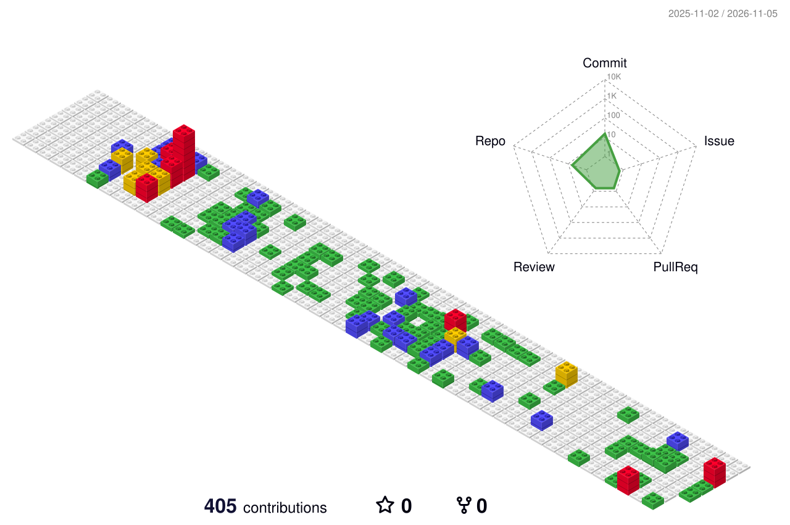

<div align="center">

# 👋 Hi there, I'm Arjun K

### 💻 Full Stack Developer | .NET · Flutter · Web & Mobile Applications

<p align="center">
  <a href="mailto:arjuntopscore@gmail.com"></a>
  <a href="mailto:arjunktp88@gmail.com"></a>
  <a href="https://github.com/arjuntopscore?tab=repositories"></a>
</p>

<p align="center">
  
  
  
</p>

</div>

---

## 🚀 About Me

```yaml
Developer: Arjun K
Specialization: Full Stack Web & Cross-Platform Mobile Applications
Core Stack:
  - Backend: C#, ASP.NET MVC 5, Web API 2, Entity Framework 6, SQL Server
  - Mobile: Flutter, Dart, Provider, GetIt, Firebase
  - Web & Frontend: JavaScript, TypeScript, React, Tailwind CSS, Bootstrap, jQuery
Current Focus: Enterprise educational ERP systems & cross-platform mobile solutions
```

- 🏫 **EdTech Engineering**: Developing enterprise campus management solutions covering multi-role operations for Administrators, Teachers, Students, Parents, and Drivers.
- ⚙️ **Full-Cycle Delivery**: Building and maintaining server-side business logic, database architectures, and REST APIs alongside dynamic client interfaces.
- 📱 **Mobile Development**: Architecting clean Flutter feature modules with robust state management, offline caching, and responsive cross-platform UI.
- 🤝 **Collaborative Engineering**: Active contributor across sprint workflows, code reviews, automated CI/CD pipelines, and multi-branch release coordination.

---

## 🧊 Interactive Contribution Timeline

<div align="center">

### 🐍 The Commit Eater · Live 365-Day Contribution Calendar
> 💡 An interactive arcade animation of my real-time GitHub activity. **Month columns (Nov 2025 ➔ Nov 2026)** and **Day rows (Mon, Wed, Fri)** are displayed directly on the grid as the snake navigates through the timeline eating daily commits!

<picture>
  <source media="(prefers-color-scheme: dark)" srcset="https://raw.githubusercontent.com/arjuntopscore/arjuntopscore/main/dist/github-contribution-grid-snake-dark.svg?v=3">
  <source media="(prefers-color-scheme: light)" srcset="https://raw.githubusercontent.com/arjuntopscore/arjuntopscore/main/dist/github-contribution-grid-snake.svg?v=3">
  
</picture>

<br/>

### 🏙️ 3D Contribution Skyline (52-Week Isometric View)
> 💡 **What is this?** An isometric 3D architectural rendering of the full year. The height and color of each 3D pillar represent the volume of commits and code shipped on that day.

<!-- 3D Axes Explainer -->
<table>
  <tr>
    <td align="center"><b>🗓️ Year & Range</b></td>
    <td align="center"><b>📐 3D Grid Coordinates</b></td>
    <td align="center"><b>📊 Chart Readings</b></td>
  </tr>
  <tr>
    <td align="center"><b>November 2025 ➔ November 2026</b><br/><sub>Full 12-month calendar cycle</sub></td>
    <td align="center"><b>Isometric Columns:</b> 52 Weeks (Nov '25 on left ➔ Nov '26 on right)<br/><b>Isometric Rows:</b> 7 Days of the week (Sunday through Saturday)</td>
    <td align="center"><b>Tower Height:</b> Daily commit volume<br/><b>Radar Chart (right):</b> Total Commit / Repo activity</td>
  </tr>
</table>

<!-- 3D Contribution Graph with Dark/Light Support -->
<picture>
  <source media="(prefers-color-scheme: dark)" srcset="https://raw.githubusercontent.com/arjuntopscore/arjuntopscore/main/profile-3d-contrib/profile-night-rainbow.svg?v=2">
  <source media="(prefers-color-scheme: light)" srcset="https://raw.githubusercontent.com/arjuntopscore/arjuntopscore/main/profile-3d-contrib/profile-season-animate.svg?v=2">
  
</picture>

<p align="center">
  <sub>✨ <b>Pillars grow proportionally to daily commit volume · Automatically refreshed daily</b> ✨</sub>
</p>

<details>
<summary><b>🔍 Click to preview alternative 3D views & themes</b></summary>
<br/>

| **🍃 Seasonal Cycle (Animated)** | **🟢 Isometric Emerald (Animated)** |
|:---:|:---:|
|  |  |

| **🌌 Midnight Skyline View** | **🧱 Git Block Theme** |
|:---:|:---:|
|  |  |

</details>

<br/>

<!-- Verified Multi-Stack Distribution -->
<div align="center">

### 📊 Full Stack Language & Technology Distribution

| Language / Framework | Ecosystem | Primary Focus & Modules | Contribution Weight |
|:---|:---|:---|:---:|
|  **C# / .NET** | Enterprise Backend | ASP.NET MVC 5, Web API 2, Entity Framework 6, Gate Pass, HPC Reports, Clean Architecture | `████████████████████` **45%** |
|  **Flutter / Dart** | Cross-Platform Mobile | Provider, GetIt, Native Fee Payments, Homework Engine, Principal Dashboard | `█████████████` **30%** |
|  **TypeScript / React** | Modern Web Apps | Type-safe state management, React components, REST APIs | `██████` **15%** |
|  **JavaScript / UI** | Frontend & Web UI | jQuery, Bootstrap 5, Razor Views, Dynamic DOM Manipulation | `████` **10%** |

</div>

</div>

---

## 🛠️ Tech Stack & Tooling

<div align="center">

### Backend & Database


### Mobile Development


### Frontend & Web UI


### DevOps, Workflow & Tools


</div>

---

## 🏆 Featured Work: Smart Campus Ecosystem

> An enterprise campus management platform connecting administrators, teachers, students, parents, and transport staff in real time.

<table>
<tr>
<th width="50%">🌐 Smart Campus Web Platform</th>
<th width="50%">📱 Smart Campus Mobile App</th>
</tr>
<tr>
<td valign="top">

**Core Stack:** `ASP.NET MVC 5` · `Web API 2` · `EF 6` · `SQL Server` · `jQuery` · `Bootstrap 5`

Enterprise campus management application structured on **Clean Architecture** patterns (Core, Application, Infrastructure, Web) serving role-specific web portals alongside REST APIs consumed by mobile clients.

#### 🔍 Verified Contributions (680+ Commits):
- **Digital Gate Pass System**: End-to-end parent request workflow, dynamic authority approvals, role notification wiring, and security gate check interface.
- **Holistic Progress Card (HPC) & Assessment Engine**: Dynamic PDF generation, batch-to-term mapping, competency allocations, teacher assessment grids, and pixel-precise print preview styles.
- **Incident Management System**: Master configuration with multi-role permissions, points-based severity mapping, report logging, and Action Taken tracking.
- **Fee Management & Defaulter Tools**: Enhanced student fee installment aggregation, balance computation, and SMS gateway balance monitoring.
- **Security & Quality**: Enforced parameter validation preventing open-redirect and CRLF injection vulnerabilities; addressed cross-browser mobile responsiveness issues.
- **Transport & Asset Tracking**: Vehicle maintenance records with payment/ledger binding and manual remarks persistence for student route allocations.

</td>
<td valign="top">

**Core Stack:** `Flutter 3.x` · `Dart` · `Provider` · `GetIt` · `Firebase (FCM/Crashlytics)`

Multi-role cross-platform mobile application supporting runtime role switching across Student, Parent, Staff, and Driver profiles with native platform capabilities.

#### 🔍 Verified Contributions (67 Commits):
- **Homework Module**: Full feature implementation scoping creation to teacher batches, subject-based filtering, and real-time synchronization.
- **Native Fee Payment History**: Transformed web-based views into high-performance native Flutter screens with downloadable PDF payment receipts.
- **Principal Dashboard**: Paginated faculty and staff directories, instant search, and detailed profile inspection screens.
- **Device & Rendering Optimizations**: Resolved multi-page PDF report card page-break bugs specifically observed on Samsung devices.
- **Attendance & Communication**: Added empty-state UI handling, sibling-switching attendance view fixes, and deep-link notification routing.
- **CI/CD & Release Workflow**: Optimized Android UAT build workflows, memory management during packaging, and coordinated multiple PR merges across release branches.

</td>
</tr>
</table>

> *Note: Smart Campus repositories are private organization assets of [Topscore Solutions](https://github.com/Topscore-Solutions). Access to source repositories is restricted to authorized team members.*

---

## 📈 Enterprise Contribution Highlights

<div align="center">

| Module / Scope | Repository | Verified Activity | Key Impact Areas |
|:---|:---:|:---:|:---|
| **Campus Web ERP** | `smart-campus` | **684+ commits** · 30+ PR merges | Gate Pass, HPC Reports, Incident System, Fee Defaulters, Security Hardening |
| **Cross-Platform App** | `smartcampus-mobile-app` | **67 commits** · 6+ PR merges | Homework Management, Native Payments, Principal Dashboard, PDF Exports |

</div>

---

## ⚡ Open Source & Personal Projects

<table>
<tr>
<td width="50%" valign="top">

### 🎵 [Musicify](https://github.com/arjuntopscore/muicfy)
A Flutter music player featuring background audio playback, custom playlists, and local library indexing.

`Flutter` `Dart` `Audio`

</td>
<td width="50%" valign="top">

### 🛍️ [Vintage Factory](https://github.com/arjuntopscore/Vintage-Factory)
A full-stack e-commerce platform with storefront interface, inventory management, and administrative dashboards.

`Next.js` `Express` `MongoDB`

</td>
</tr>
<tr>
<td width="50%" valign="top">

### 🎧 [JioSaavn API 2](https://github.com/arjuntopscore/jiosaavn-api2)
A TypeScript wrapper service centered around the JioSaavn music API with structured data models.

`TypeScript` `REST API` `Node.js`

</td>
<td width="50%" valign="top">

### 📱 [Learn Flutter](https://github.com/arjuntopscore/Learn-flutter-)
Curated Flutter experiments, component sandboxes, and architectural pattern explorations.

`Flutter` `Dart` `UI/UX`

</td>
</tr>
</table>

---

<div align="center">

### 📫 Get in Touch

Feel free to connect regarding software engineering opportunities, mobile development, or collaboration:

[](mailto:arjuntopscore@gmail.com)
[](mailto:arjunktp88@gmail.com)
[](https://github.com/arjuntopscore)

<br/>

**BUILD · SHIP · LEARN · REPEAT**

</div>
